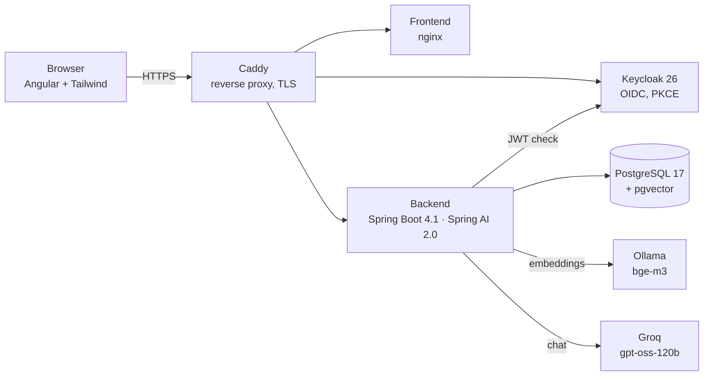

<p align="center">
  
</p>

<p align="center">
  <b>English</b> · <a href="README.it.md">Italiano</a> · <a href="README.es.md">Español</a>
</p>

<p align="center">
  <a href="https://github.com/Giugo18/docai/actions/workflows/backend.yml"></a>
  <a href="https://github.com/Giugo18/docai/actions/workflows/frontend.yml"></a>
  
  
  
  
</p>

# Leggio18 (DocAI)

**Ask questions to your PDF documents and get answers with sources.**
Leggio18 indexes your PDFs, finds the passages that matter and lets an AI model answer *only* from them, citing every claim as `[Source N]` with file name and page.
The internal codename is `docai` (packages, realm, repository); the public name is Leggio18, from *leggio*, the lectern that holds a document open while you read it.

> A personal learning project: built week by week to study modern Java, Spring AI and AI engineering end to end — from the first `docker compose up` to a production server with CI/CD.

## Features

- **Upload and indexing** — PDFs are split into chunks and embedded in the background (Ollama + `bge-m3`, 1024-dim vectors in pgvector); a scheduler resumes interrupted jobs.
- **Hybrid search** — semantic similarity and keyword search merged with Reciprocal Rank Fusion, filtered by owner and optionally by document.
- **Answers with citations** — the model answers only from the retrieved passages; citations are normalised and checked, so invented sources are detected.
- **Conversations with an agent** — in a conversation the model uses tools: list your documents, search inside them, propose a rename that you confirm with a button.
- **Multi-step agent** — tasks such as "sum the totals of my invoices", with a step limit and duplicate-invoice detection.
- **Invoice data extraction** — structured output from an invoice PDF.
- **MCP server** — the same search is exposed as Model Context Protocol tools for external AI clients.
- **Admin area** — token usage and estimated cost per user and model.
- **Evaluation harness** — 26 test cases (RAG, assistant, agent; single questions, conversations, repeated runs) that measure retrieval, citations and answers before every prompt change.
- **Polished UI** — light/dark theme, mobile layout, accessible controls, custom Keycloak login theme.

## Architecture



| Layer | Technology |
|---|---|
| Backend | Java 21 (virtual threads, records, sealed interfaces, pattern matching), Spring Boot 4.1, Spring Security (OAuth2 resource server), Spring Data JPA, Flyway, Spring AI 2.0 |
| AI | Groq `openai/gpt-oss-120b` for chat (OpenAI-compatible API), Ollama `bge-m3` for embeddings, pgvector with HNSW index |
| Identity | Keycloak 26 — realm as code, PKCE, audience mapper, custom login theme |
| Frontend | Angular (standalone components, signals), Tailwind CSS 4 |
| Data | PostgreSQL 17 + pgvector, Flyway migrations, optimistic locking (`@Version`) |
| Ops | Docker Compose, Caddy (automatic HTTPS), GitHub Actions, multi-arch images (amd64/arm64) on GHCR, Hetzner ARM server, nightly `pg_dumpall` backups |
| Quality | JUnit 5, Testcontainers, deterministic concurrency tests, RAG evaluation suite, Dependabot |

## Engineering notes

A few problems solved along the way, each documented in the project diary:

- **Lost update** between background indexing and a user rename — fixed with targeted `UPDATE` queries plus `@Version` as a safety net; reproduced by deterministic tests.
- **Request id in streaming errors** — with a `Flux` the error arrives on an async dispatch thread where the MDC is empty; the filter now stores the id as a request attribute and runs on async dispatch too.
- **Agent query drift** — after a question about Caddy, "does it use Java?" was searched as "Caddy uses Java"; fixed in the tool description and prompt, then locked in by an evaluation case that replays the conversation.
- **Errors as `ProblemDetail`** (RFC 9457) everywhere, including a 503 when the AI provider is unavailable.

## Run it locally

Requirements: JDK 21, Maven, Node.js 24, Docker.

```bash
# 1. Infrastructure: Postgres + Keycloak (+ Ollama for embeddings)
cp .env.example .env            # set DB_PASSWORD, KC_ADMIN_PASSWORD, KEYCLOAK_URL
docker compose --profile ai up -d
docker exec docai-ollama ollama pull bge-m3

# 2. Backend (port 8080) — the Groq key comes from an environment variable, never from files
export GROQ_API_KEY=...         # PowerShell: $env:GROQ_API_KEY = "..."
cd backend && mvn spring-boot:run -Dspring-boot.run.profiles=dev

# 3. Frontend (port 4200)
cd frontend && npm install && npm start
```

Everything in containers: `docker compose --profile ai --profile app up -d --build`.

## Project status

Deployed on a private server for a small group of invited users. The full week-by-week diary (in Italian) covers every decision, mistake and fix.

---

Built by [Giugo18](https://github.com/Giugo18).
