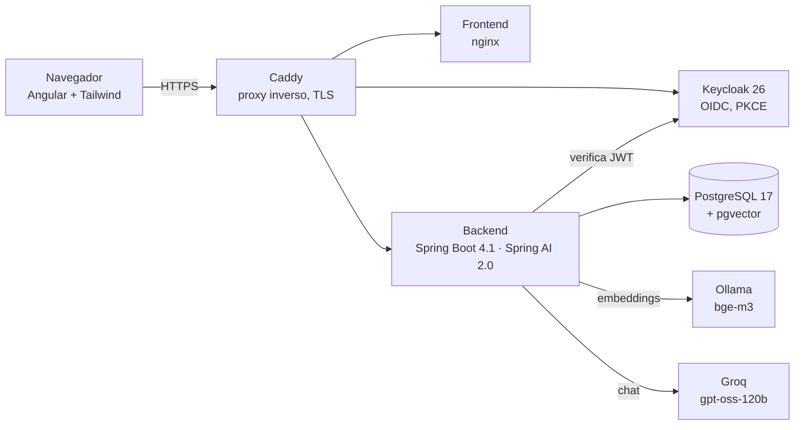

<p align="center">
  
</p>

<p align="center">
  <a href="README.md">English</a> · <a href="README.it.md">Italiano</a> · <b>Español</b>
</p>

<p align="center">
  <a href="https://github.com/Giugo18/docai/actions/workflows/backend.yml"></a>
  <a href="https://github.com/Giugo18/docai/actions/workflows/frontend.yml"></a>
  
  
  
  
</p>

# Leggio18 (DocAI)

**Haz preguntas a tus documentos PDF y recibe respuestas con sus fuentes.**
Leggio18 indexa tus PDF, encuentra los pasajes relevantes y deja que un modelo de inteligencia artificial responda *solo* a partir de ellos, citando cada dato como `[Fuente N]` con el nombre del archivo y la página.
El nombre interno es `docai` (paquetes, realm, repositorio); el nombre público es Leggio18: *leggio* es el atril que mantiene abierto el documento mientras lo consultas.

> Un proyecto personal de aprendizaje: construido semana a semana para estudiar Java moderno, Spring AI y la ingeniería de IA de principio a fin, desde el primer `docker compose up` hasta un servidor de producción con CI/CD.

## Funcionalidades

- **Carga e indexación** — los PDF se dividen en fragmentos (chunks) y se convierten en vectores en segundo plano (Ollama + `bge-m3`, vectores de 1024 en pgvector); un planificador retoma los trabajos interrumpidos.
- **Búsqueda híbrida** — similitud semántica y búsqueda por palabras combinadas con Reciprocal Rank Fusion, filtradas por propietario y, opcionalmente, por documento.
- **Respuestas con citas** — el modelo responde solo con los pasajes encontrados; las citas se normalizan y se comprueban, así se detectan las fuentes inventadas.
- **Conversaciones con un agente** — en una conversación el modelo usa herramientas: lista tus documentos, busca dentro de ellos y propone un cambio de nombre que confirmas con un botón.
- **Agente de varios pasos** — tareas como "suma los totales de mis facturas", con un límite de pasos y detección de facturas duplicadas.
- **Extracción de datos de facturas** — salida estructurada a partir de un PDF de factura.
- **Servidor MCP** — la misma búsqueda se expone como herramientas Model Context Protocol para clientes de IA externos.
- **Área de administración** — tokens usados y coste estimado por usuario y modelo.
- **Evaluación automática** — 26 casos de prueba (RAG, asistente, agente; preguntas sueltas, conversaciones, ejecuciones repetidas) que miden la recuperación, las citas y las respuestas antes de cada cambio en los prompts.
- **Interfaz cuidada** — tema claro/oscuro, diseño para móvil, controles accesibles, tema personalizado para el inicio de sesión de Keycloak.

## Arquitectura



| Capa | Tecnología |
|---|---|
| Backend | Java 21 (virtual threads, records, sealed interfaces, pattern matching), Spring Boot 4.1, Spring Security (OAuth2 resource server), Spring Data JPA, Flyway, Spring AI 2.0 |
| IA | Groq `openai/gpt-oss-120b` para el chat (API compatible con OpenAI), Ollama `bge-m3` para los embeddings, pgvector con índice HNSW |
| Identidad | Keycloak 26 — realm como código, PKCE, audience mapper, tema de inicio de sesión personalizado |
| Frontend | Angular (componentes standalone, signals), Tailwind CSS 4 |
| Datos | PostgreSQL 17 + pgvector, migraciones Flyway, bloqueo optimista (`@Version`) |
| Operaciones | Docker Compose, Caddy (HTTPS automático), GitHub Actions, imágenes multiarquitectura (amd64/arm64) en GHCR, servidor ARM de Hetzner, copias de seguridad nocturnas con `pg_dumpall` |
| Calidad | JUnit 5, Testcontainers, pruebas de concurrencia deterministas, evaluación del RAG, Dependabot |

## Notas de ingeniería

Algunos problemas resueltos por el camino, cada uno documentado en el diario del proyecto:

- **Lost update** entre la indexación en segundo plano y el cambio de nombre hecho por el usuario — resuelto con `UPDATE` específicos más `@Version` como red de seguridad; reproducido con pruebas deterministas.
- **Id de la petición en los errores en streaming** — con un `Flux` el error llega en un hilo de async dispatch donde el MDC está vacío; el filtro ahora guarda el id como atributo de la petición y se ejecuta también en el async dispatch.
- **La consulta del agente que "arrastra" el tema** — después de una pregunta sobre Caddy, "¿usa Java?" se buscaba como "Caddy usa Java"; corregido en la descripción de la herramienta y en el prompt, y fijado con un caso de evaluación que reproduce la conversación.
- **Errores como `ProblemDetail`** (RFC 9457) en todas partes, incluido un 503 cuando el proveedor de IA no está disponible.

## Ejecución en local

Requisitos: JDK 21, Maven, Node.js 24, Docker.

```bash
# 1. Infraestructura: Postgres + Keycloak (+ Ollama para los embeddings)
cp .env.example .env            # definir DB_PASSWORD, KC_ADMIN_PASSWORD, KEYCLOAK_URL
docker compose --profile ai up -d
docker exec docai-ollama ollama pull bge-m3

# 2. Backend (puerto 8080) — la clave de Groq viene de una variable de entorno, nunca de un archivo
export GROQ_API_KEY=...         # PowerShell: $env:GROQ_API_KEY = "..."
cd backend && mvn spring-boot:run -Dspring-boot.run.profiles=dev

# 3. Frontend (puerto 4200)
cd frontend && npm install && npm start
```

Todo en contenedores: `docker compose --profile ai --profile app up -d --build`.

## Estado del proyecto

Desplegado en un servidor privado para un pequeño grupo de usuarios invitados. El diario completo, semana a semana (en italiano), recoge cada decisión, error y corrección.

---

Hecho por [Giugo18](https://github.com/Giugo18).
