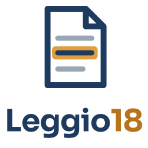
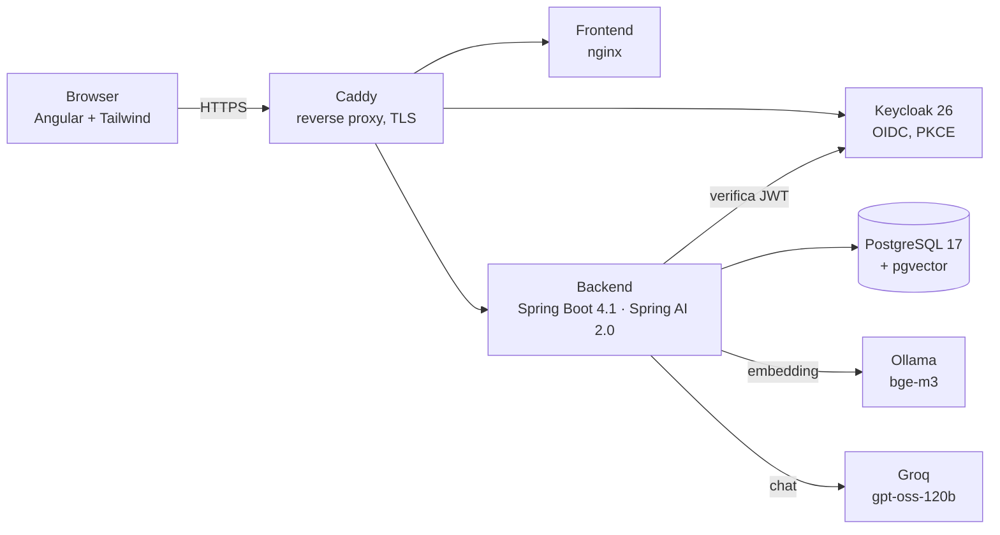

<p align="center">
  
</p>

<p align="center">
  <a href="README.md">English</a> · <b>Italiano</b> · <a href="README.es.md">Español</a>
</p>

<p align="center">
  <a href="https://github.com/Giugo18/docai/actions/workflows/backend.yml"></a>
  <a href="https://github.com/Giugo18/docai/actions/workflows/frontend.yml"></a>
  
  
  
  
</p>

# Leggio18 (DocAI)

**Fai domande ai tuoi documenti PDF e ricevi risposte con le fonti.**
Leggio18 indicizza i tuoi PDF, trova i passaggi che contano e lascia che un modello di intelligenza artificiale risponda *solo* a partire da quelli, citando ogni informazione come `[Fonte N]` con nome del file e pagina.
Il nome interno è `docai` (package, realm, repository); il nome pubblico è Leggio18: il leggio è ciò che tiene aperto il documento mentre lo consulti.

> Un progetto personale di apprendimento: costruito settimana per settimana per studiare Java moderno, Spring AI e l'AI engineering dall'inizio alla fine, dal primo `docker compose up` a un server di produzione con CI/CD.

## Funzionalità

- **Caricamento e indicizzazione** — i PDF vengono divisi in chunk e trasformati in vettori in background (Ollama + `bge-m3`, vettori da 1024 in pgvector); uno scheduler riprende i lavori interrotti.
- **Ricerca ibrida** — similarità semantica e ricerca per parole unite con la Reciprocal Rank Fusion, filtrate per proprietario ed eventualmente per documento.
- **Risposte con citazioni** — il modello risponde solo dai passaggi trovati; le citazioni vengono normalizzate e controllate, così le fonti inventate vengono riconosciute.
- **Conversazioni con un agente** — in una conversazione il modello usa degli strumenti: elenca i tuoi documenti, cerca al loro interno, propone una rinomina che confermi con un pulsante.
- **Agente a più passaggi** — compiti come "somma i totali delle mie fatture", con un limite di passi e il riconoscimento delle fatture duplicate.
- **Estrazione dei dati di una fattura** — output strutturato da un PDF di fattura.
- **Server MCP** — la stessa ricerca è esposta come strumenti Model Context Protocol per client AI esterni.
- **Area di amministrazione** — token usati e costo stimato per utente e modello.
- **Valutazione automatica** — 26 casi di prova (RAG, assistente, agente; domande singole, conversazioni, esecuzioni ripetute) che misurano recupero, citazioni e risposte prima di ogni modifica ai prompt.
- **Interfaccia curata** — tema chiaro/scuro, layout per telefono, controlli accessibili, tema personalizzato per il login di Keycloak.

## Architettura



| Livello | Tecnologia |
|---|---|
| Backend | Java 21 (virtual thread, record, sealed interface, pattern matching), Spring Boot 4.1, Spring Security (OAuth2 resource server), Spring Data JPA, Flyway, Spring AI 2.0 |
| AI | Groq `openai/gpt-oss-120b` per la chat (API compatibile OpenAI), Ollama `bge-m3` per gli embedding, pgvector con indice HNSW |
| Identità | Keycloak 26 — realm come codice, PKCE, audience mapper, tema di login personalizzato |
| Frontend | Angular (componenti standalone, signal), Tailwind CSS 4 |
| Dati | PostgreSQL 17 + pgvector, migration Flyway, optimistic locking (`@Version`) |
| Operazioni | Docker Compose, Caddy (HTTPS automatico), GitHub Actions, immagini multi-architettura (amd64/arm64) su GHCR, server ARM Hetzner, backup notturni con `pg_dumpall` |
| Qualità | JUnit 5, Testcontainers, test di concorrenza deterministici, valutazione del RAG, Dependabot |

## Note di ingegneria

Alcuni problemi risolti strada facendo, ognuno documentato nel diario del progetto:

- **Lost update** tra l'indicizzazione in background e la rinomina da parte dell'utente — risolto con `UPDATE` mirati più `@Version` come rete di sicurezza; riprodotto con test deterministici.
- **Id della richiesta negli errori in streaming** — con un `Flux` l'errore arriva su un thread di async dispatch dove l'MDC è vuoto; il filtro ora salva l'id come attributo della richiesta e gira anche nell'async dispatch.
- **La query dell'agente che "trascina" l'argomento** — dopo una domanda su Caddy, "usa java?" veniva cercata come "Caddy usa Java"; corretto nella descrizione dello strumento e nel prompt, poi bloccato da un caso di valutazione che riproduce la conversazione.
- **Errori come `ProblemDetail`** (RFC 9457) ovunque, compreso un 503 quando il servizio AI non è disponibile.

## Avvio in locale

Requisiti: JDK 21, Maven, Node.js 24, Docker.

```bash
# 1. Infrastruttura: Postgres + Keycloak (+ Ollama per gli embedding)
cp .env.example .env            # impostare DB_PASSWORD, KC_ADMIN_PASSWORD, KEYCLOAK_URL
docker compose --profile ai up -d
docker exec docai-ollama ollama pull bge-m3

# 2. Backend (porta 8080) — la chiave di Groq arriva da una variabile d'ambiente, mai da un file
export GROQ_API_KEY=...         # PowerShell: $env:GROQ_API_KEY = "..."
cd backend && mvn spring-boot:run -Dspring-boot.run.profiles=dev

# 3. Frontend (porta 4200)
cd frontend && npm install && npm start
```

Tutto in container: `docker compose --profile ai --profile app up -d --build`.

## Stato del progetto

In produzione su un server privato, per un piccolo gruppo di utenti invitati. Il diario completo, settimana per settimana, racconta ogni decisione, errore e correzione.

---

Realizzato da [Giugo18](https://github.com/Giugo18).
